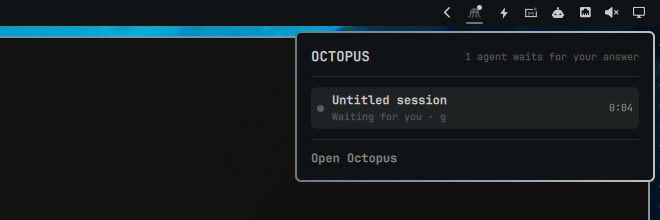

# Octopus for Omarchy

A bar widget and theme sync for [Octopus](https://github.com/SkvorikovCode/Octopus-AI), the desktop app for coding agents.

One icon in the Omarchy bar shows the state of your agents:
- in the theme's urgent color, with a dot, while an agent waits for your answer (the dot keeps it visible in monochrome themes, where "urgent" is a gray);
- in the bar's text color while agents work;
- dimmed while they are idle.

While Octopus is not running the icon is not in the bar at all.

Click it for the list of agents: title, project, branch of a worktree copy, and how long the current turn has run. Click a row to open that session in Octopus. Right-click opens the Octopus window.



Octopus also follows the current Omarchy theme: on every `omarchy theme set` the plugin writes the theme's colors for Octopus, and an open window repaints within a couple of seconds (Settings → Theme → Desktop, on by default until you pick another theme).

## Requirements

- Omarchy with the Quattro shell (plugin support).
- Octopus 0.3 or newer. Octopus writes `$XDG_RUNTIME_DIR/octopus/status.json`, accepts `--show` and `--session <id>`, and follows `~/.config/octopus/palette.json`; the plugin only reads the status file, runs `octopus-ai` and writes the palette.

## Install

```sh
omarchy plugin add https://github.com/SkvorikovCode/omarchy-octopus.git --enable
```

From a local checkout:

```sh
omarchy plugin add ~/code/omarchy-octopus --enable
```

## Configure

If Octopus is not on your `PATH` as `octopus-ai` (an AppImage, a build from source), point the widget at it:

```sh
omarchy bar set skvorikovcode.octopus command /path/to/octopus-ai
```

Keep a dimmed icon while Octopus is closed, to start it from the bar:

```sh
omarchy bar set skvorikovcode.octopus showWhenClosed true --json
```

Move the icon:

```sh
omarchy bar move skvorikovcode.octopus --section right
```

## How it works

Octopus writes `$XDG_RUNTIME_DIR/octopus/status.json` atomically whenever an agent's status changes, and removes it on exit. The widget watches that file, and checks `/proc/<pid>/comm` so that a file left by a crash does not show stale agents. Commands run through `uwsm-app` as an argument list, never through a shell.

The theme sync (`ThemeSync.qml`, a service) watches `~/.local/state/omarchy/current/theme.name`. On a switch it reads the theme's `colors.toml`, derives Octopus's colors in `Theme.js`, and writes `~/.config/octopus/palette.json` atomically, only when the palette changed:
- In dark themes the page is the theme's background, and tiles are mixed a few percent towards the text color.
- In light themes the tiles are the theme's background, on a page a step darker.
- Dimmer text steps keep at least 4.5:1 contrast on their tiles (muted text 4:1, the dimmest 3:1).
- Text on accent buttons is the background, the text color, white or black, whichever reads at 4.5:1 first.

## Develop

```sh
node --test tests/
omarchy plugin validate .
qmllint -I "$OMARCHY_PATH/shell" Panel.qml Service.qml ThemeSync.qml
```

The shell reloads a changed plugin on save, but a bar widget that is already placed can keep running the previous QML. Run `omarchy restart shell` before judging a change.

## Remove

```sh
omarchy plugin remove skvorikovcode.octopus
```

## License

[Apache-2.0](LICENSE)
